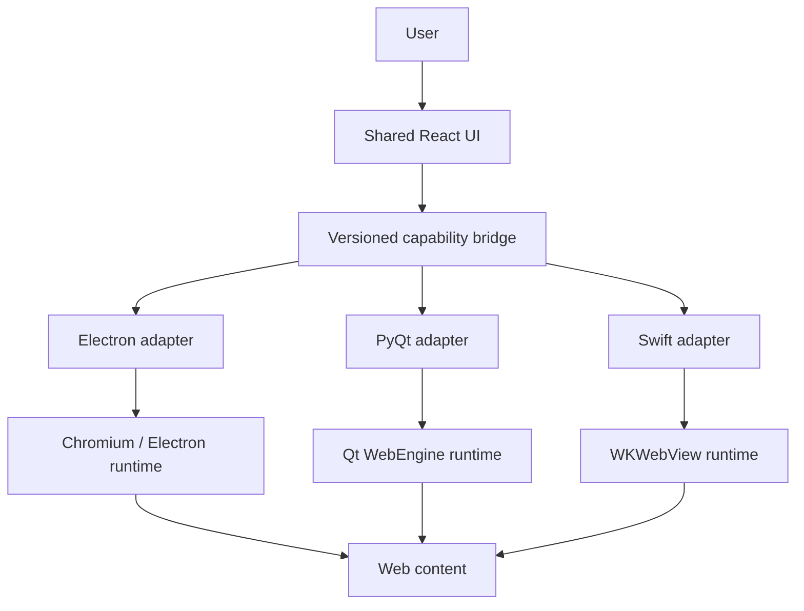
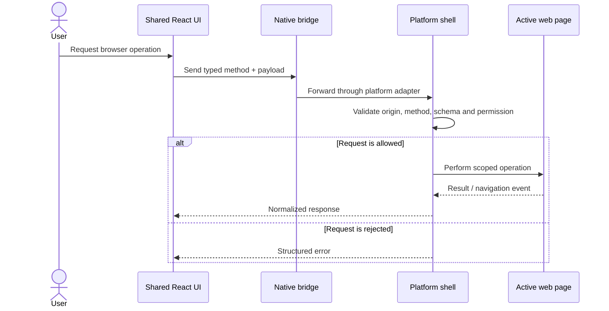

<div align="center">

# Loonakulf Browser

**A bookmarklet-first browser for building, organizing and running personal web tools across desktop and mobile shells.**

[](https://github.com/auraecosystem/loonakulf-browser/actions/workflows/ci-build-pipeline.yml)
[](shared-react-ui/)
[](#project-status)

[Repository](https://github.com/auraecosystem/loonakulf-browser) · [Documentation](docs/) · [Issues](https://github.com/auraecosystem/loonakulf-browser/issues) · [CI runs](https://github.com/auraecosystem/loonakulf-browser/actions)

**Hosted demo:** [Open the demo deployment](https://auraecosystem.github.io/loonakulf-browser/)  
<sub>The Pages URL is the planned public preview. It will become available after GitHub Pages is enabled and the deployment workflow completes successfully. Until then, run the app locally using the quick-start below.</sub>

</div>

---

## Overview

Loonakulf Browser is designed as a bookmarklet-first, multi-shell browser. Bookmarklets are a primary product primitive: users should be able to create, inspect, organize, test, run and export small tools for the active web page. A shared interface coordinates platform-specific native containers.

The shared UI owns the browser-facing experience and reusable workflows. Native shells own platform lifecycle, web rendering, navigation policy and privileged operations. The goal is to avoid maintaining three separate browser interfaces while keeping platform-specific capabilities behind narrow, validated interfaces.

### Project visuals

#### Browser interface concept

<p align="center">
  
</p>

This is a design direction for the shared browser experience, not a screenshot or claim that every illustrated control is already implemented. It keeps the browser surface central, makes bookmarklets discoverable, and keeps privacy and permission state visible.

#### System architecture

<p align="center">
  
</p>

<p align="center">
  
</p>

These are architecture illustrations, not screenshots of a completed native application.

## Current capabilities

| Area | Current implementation |
|---|---|
| Shared browser UI | React 18 application and shared browser dashboard |
| Bookmarklets | Local library, builder, bounded source validation, static risk findings and native per-run consent dialogs with source previews |
| Browser controls | Navigation, proxy and cache-control UI paths |
| Platform intelligence | Browser, engine, OS, device and CPU identification |
| Client Hints | Low-entropy hints and opt-in high-entropy retrieval with fallback |
| Electron | Main/preload separation, trusted UI-origin checks, bounded bookmarklet IPC and native per-run confirmation |
| PyQt | Qt WebEngine prototype with UI-origin validation, bounded requests and per-run native confirmation |
| Swift | UIKit/WKWebView prototype with main-frame origin checks and per-run native confirmation |

**Security status:** the feature branch now requires native confirmation for each bookmarklet run and checks the trusted local UI origin, target origin and request bounds in each shell. These shells remain prototypes: their trusted UI is currently hard-coded to `http://localhost:3000`, packaged-origin support and end-to-end tests are not complete, and consent does not make untrusted code safe. See [security and architecture notes](docs/multishell-architecture.md).

## Architecture

### System context



### Request and permission flow



### Design rules

1. **One UI, multiple shells.** Shared workflows belong in `shared-react-ui`; native lifecycle and OS integration belong in the shell.
2. **Capabilities, not User-Agent privilege checks.** User-Agent strings and Client Hints are advisory diagnostics, never authorization signals.
3. **Validate at the native boundary.** UI-side validation is not a security boundary.
4. **No generic native execution.** Do not expose unrestricted `eval`, arbitrary shell commands, filesystem access or unrestricted IPC.
5. **Explicit consent for privileged actions.** Bookmarklet execution must be separately permissioned and confirmed.
6. **Privacy by default.** Request high-entropy Client Hints only when a user action and concrete feature require them.

## Repository layout

```text
loonakulf-browser/
├── .github/
│   └── workflows/
│       ├── ci-build-pipeline.yml
│       └── deploy-pages.yml
├── assets/
│   └── js/
│       └── platform.js
├── docs/
│   ├── assets/
│   │   ├── loonakulf-architecture.svg
│   │   ├── loonakulf-runtime-flow.svg
│   │   └── loonakulf-ui-concept.svg
│   ├── bookmarklet-first-architecture.md
│   ├── Dependencies.md
│   ├── UA-parser.md
│   ├── architecture.md
│   ├── demo.md
│   ├── multishell-architecture.md
│   └── platform-intelligence-audit.md
├── electron-shell/
│   ├── main.js
│   ├── platform.js
│   └── preload.js
├── pyqt-shell/
│   └── main.py
├── shared-react-ui/
│   ├── public/
│   │   └── index.html
│   ├── src/
│   │   ├── App.js
│   │   ├── bookmarks/
│   │   │   └── runtime.js
│   │   ├── db.js
│   │   ├── index.js
│   │   └── platform/
│   ├── tests/
│   │   ├── bookmarks/
│   │   └── platform/
│   └── package.json
├── swift-shell/
│   └── BrowserApp/
│       └── ViewController.swift
└── README.md
```

## Quick start

### Requirements

- Node.js 20 or a compatible supported Node.js release
- npm
- Git

### Run the shared React interface

```bash
git clone https://github.com/auraecosystem/loonakulf-browser.git
cd loonakulf-browser/shared-react-ui

npm install
npm run start
```

The development server is expected at [http://localhost:3000](http://localhost:3000).

### Test and build

Run these commands from `shared-react-ui/`:

```bash
# Platform parser regression tests
npm run test:platform

# Production build
npm run build

# Lint source files
npm run lint
```

The CI workflow runs platform and bookmarklet regression tests, a React production build, Electron syntax checks and a Python syntax check. CI must confirm the current branch before this work is considered validated. It does not compile the iOS target, produce signed native installers or prove end-to-end behavior in all three shells.

## Platform shells

### Electron — desktop

The Electron shell contains the main process, preload bridge and platform helpers.

Current source includes sender/frame and localhost UI-origin checks, navigation restrictions, URL and proxy validation, allowlisted browser-control actions, bounded bookmarklet requests and a native per-run confirmation that displays the target origin and a source preview. The trusted UI origin is currently the development server; packaged-origin support, complete end-to-end tests, an Electron packaging manifest and a release pipeline remain outstanding.

### PyQt — desktop prototype

The PyQt shell uses Qt WebEngine and Qt WebChannel. The feature branch validates the local UI origin and request shape, bounds the source, asks for native per-run confirmation with a target-origin/source preview, and rechecks the target origin before execution. It remains a prototype; packaged-origin support, navigation hardening and end-to-end tests are outstanding.

### Swift — iOS prototype

The Swift shell uses UIKit and WKWebView. The feature branch restricts UI navigation to the local development origin, validates main-frame messages and source bounds, asks for native per-run confirmation, and rechecks the target origin before execution. It remains a prototype; packaged UI-origin support, Xcode project integration and device testing are outstanding.

## Documentation

| Document | Description |
|---|---|
| [Bookmarklet-first architecture](docs/bookmarklet-first-architecture.md) | Product definition, shared runtime helpers, execution model and security requirements |
| [Multi-shell architecture](docs/multishell-architecture.md) | Shell responsibilities, bridge contract, security rules and implementation status |
| [Architecture notes](docs/architecture.md) | Existing architecture reference |
| [Dependencies](docs/Dependencies.md) | Dependency and setup notes |
| [User-Agent parser](docs/UA-parser.md) | Platform identity parsing |
| [Platform intelligence audit](docs/platform-intelligence-audit.md) | Detection behavior, limitations and privacy considerations |
| [Demo and deployment](docs/demo.md) | Local preview, GitHub Pages setup and deployment troubleshooting |

## Demo and deployment

The public preview is planned for:

**[https://auraecosystem.github.io/loonakulf-browser/](https://auraecosystem.github.io/loonakulf-browser/)**

The preview is not considered live until the repository's GitHub Pages source is set to **GitHub Actions** and the deployment workflow succeeds. See [docs/demo.md](docs/demo.md) for the exact setup steps.

The hosted preview is for the shared web UI. It does not package or emulate Electron, PyQt or native iOS functionality.

## Project status

| Milestone | Status |
|---|---|
| Bookmarklet-first shared runtime and native per-run consent | Implemented on feature branch; CI and end-to-end validation pending |
| Shared React UI foundation | Restored on this feature branch; CI validation pending |
| Platform intelligence and regression tests | Implemented; continued validation required |
| React production build in CI | Must remain green |
| Versioned shared bridge contract | Specified; implementation pending |
| Electron production hardening | In progress |
| PyQt production bridge | Not ready |
| Swift production bridge | Not ready |
| Native packaging and signed releases | Not implemented |
| Hosted web demo | Pending Pages configuration and successful deployment |

## Security

Please do not report security-sensitive vulnerabilities in public issues. Use GitHub's private vulnerability reporting if it is enabled for this repository, or contact the repository maintainers privately.

Security priorities:

- Treat all web content as untrusted.
- Validate native bridge callers and payloads in the shell.
- Restrict navigation to explicitly supported schemes.
- Keep secrets and privileged operations out of the renderer.
- Require clear user authorization for bookmarklet execution.
- Do not use device identity or User-Agent data as an authorization mechanism.

## Contributing

1. Open an issue describing the bug or proposed change.
2. Keep changes scoped to the appropriate layer.
3. Add or update tests for behavior changes.
4. Run the platform tests and production build.
5. Document new bridge methods and their security requirements.
6. Submit a pull request with test results and known limitations.

## License

A license file was not present in the repository when this README was refreshed. Confirm the project's intended license and add a root-level `LICENSE` file before publishing a license badge or accepting external contributions under a specific license.
